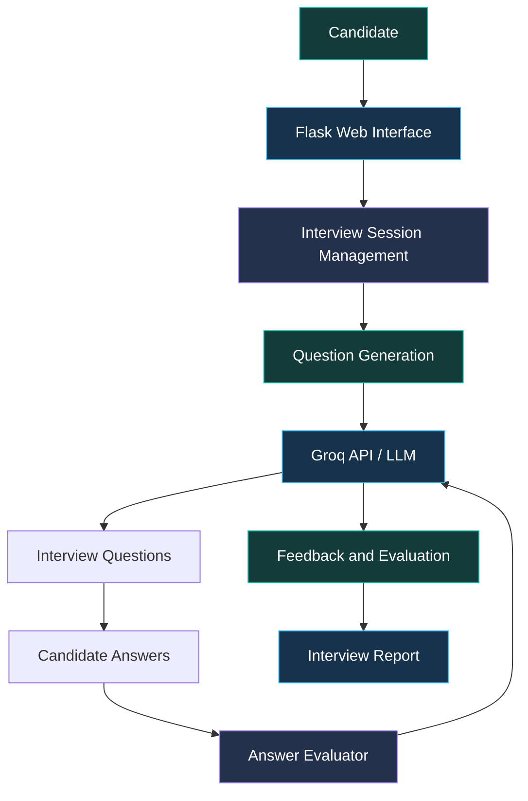

# 🤖 AI Interview Agent

<p align="center">
  <strong>AI-Powered Interview Practice, Answer Evaluation & Personalized Feedback</strong>
</p>

<p align="center">
  
  
  
  
</p>

---

## 📌 Overview

The **AI Interview Agent** is a web-based interview practice application designed to help candidates prepare for technical and role-based interviews.

The application uses Python, Flask, and a large language model through the Groq API to generate interview questions, evaluate submitted answers, and provide AI-generated feedback.

It demonstrates how backend development and language-model integration can be combined to create an interactive learning application.

## ✨ Features

- 📝 Generate interview questions for practice.
- 💬 Submit answers through a web interface.
- 🤖 Evaluate responses using an LLM API.
- 📊 Present feedback and performance insights.
- 🌐 Provide a browser-based interview workflow.
- 🔄 Organize interview progress and responses using application logic.

## 🛠️ Technology Stack

| Technology | Purpose |
|---|---|
| Python | Application logic |
| Flask | Backend web framework |
| Groq API | Language-model integration |
| HTML | User interface |
| LLM | Question generation and answer evaluation |

## 🧩 System Architecture



*Architecture represents the intended workflow; exact behavior depends on the implementation and configured API.*

## 🔄 How It Works

1. **Start an interview:** The candidate opens the web application and begins a practice session.
2. **Generate questions:** The application requests interview questions from the configured language model.
3. **Submit answers:** The candidate enters responses through the interview interface.
4. **Evaluate responses:** The evaluator sends the answer for AI-assisted analysis.
5. **Review feedback:** The application presents the generated evaluation or report, according to the configured workflow.

## 📂 Project Structure

```text
AI-Interview-Agent/
├── .gitignore
├── README.md
├── ai.py
├── app.py
├── evaluator.py
├── index.html
├── interview.html
└── report.py
```

This structure reflects the files visible in the repository screenshot. Additional templates, utility files, or configuration files may exist elsewhere in the repository.

## ⚙️ Installation and Setup

### Prerequisites

- Python installed on your system
- pip package manager
- Git
- A Groq API key if required by the application

### 1. Clone the repository

```bash
git clone https://github.com/parveenbhanu2005/AI-Interview-Agent.git
cd AI-Interview-Agent
```

### 2. Create a virtual environment

```bash
python -m venv venv
```

**Windows:**

```bash
venv\Scripts\activate
```

**Linux/macOS:**

```bash
source venv/bin/activate
```

### 3. Install dependencies

If a `requirements.txt` file is available, run:

```bash
pip install -r requirements.txt
```

If no dependency file exists, install the packages specified by your actual source code.

### 4. Configure the API key

Create an environment variable named `GROQ_API_KEY` containing your own API key if your code reads the key from the environment.

Never commit API keys, passwords, or other secrets to GitHub.

### 5. Run the application

If `app.py` is the configured Flask entry point, run:

```bash
python app.py
```

Open the local URL displayed in the terminal.

## 🔐 Security Considerations

- Store API credentials in environment variables.
- Do not expose secret keys in source files or public repositories.
- Validate user input and handle API errors safely.
- Avoid sending unnecessary personal or confidential information to external AI services.
- Treat AI-generated evaluations as guidance rather than definitive judgments of a candidate's abilities.

## 🔮 Future Enhancements

- 🎯 Role-specific interview preparation.
- 📚 Difficulty levels for interview questions.
- 📊 Structured scoring and feedback reports.
- 📈 Interview history and progress tracking.
- 🧠 Support for additional LLM providers.
- 🛡️ Improved input validation and error handling.
- 📱 Responsive interface for mobile devices.

## 👨‍💻 Developer

**B. Parveen Bhanu**

B.Tech — Computer Science Engineering (Cyber Security)  
Rajeev Gandhi Memorial College of Engineering & Technology, Andhra Pradesh

- [GitHub Profile](https://github.com/parveenbhanu2005)
- [LinkedIn](https://www.linkedin.com/in/parveen-bhanu-bandisula/)
- [Portfolio](https://parveenbhanu-portflio.netlify.app/)
- [LeetCode](https://leetcode.com/u/ParveenBhanu/)

---

<p align="center">
  <strong>Building practical AI applications through Python and intelligent automation.</strong>
</p>
